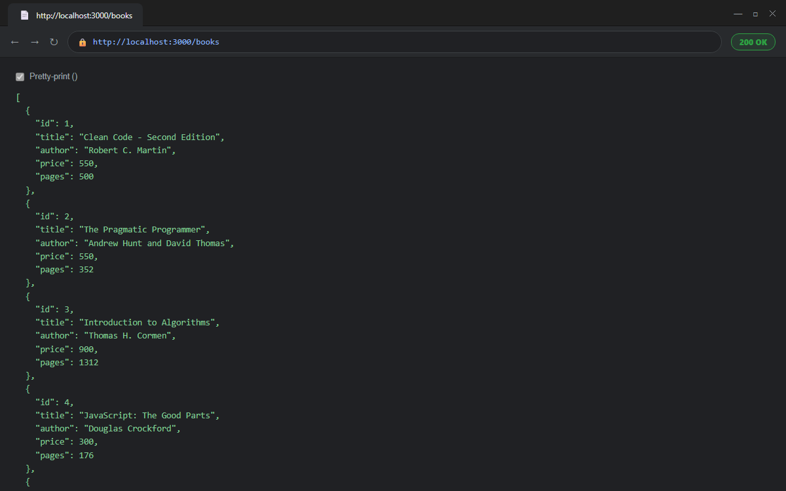
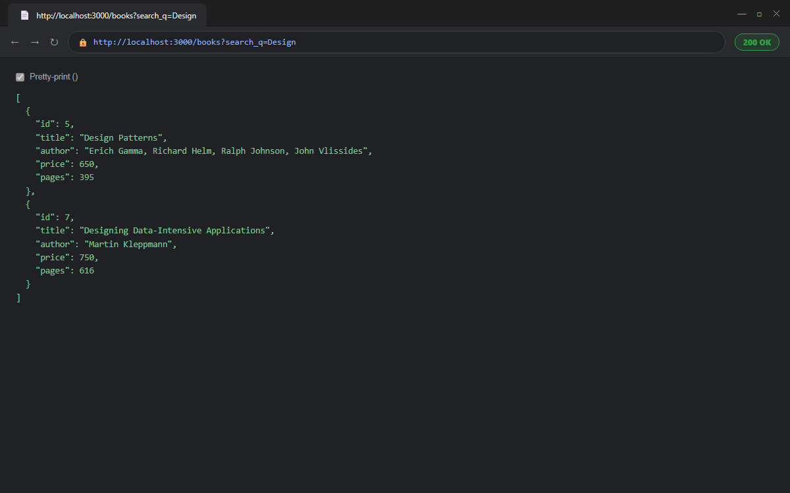
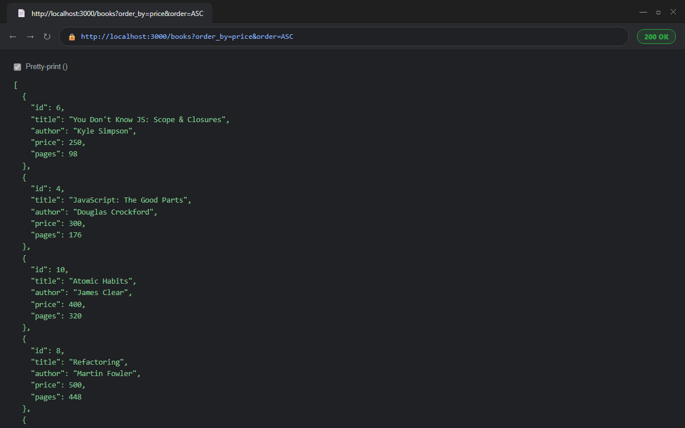
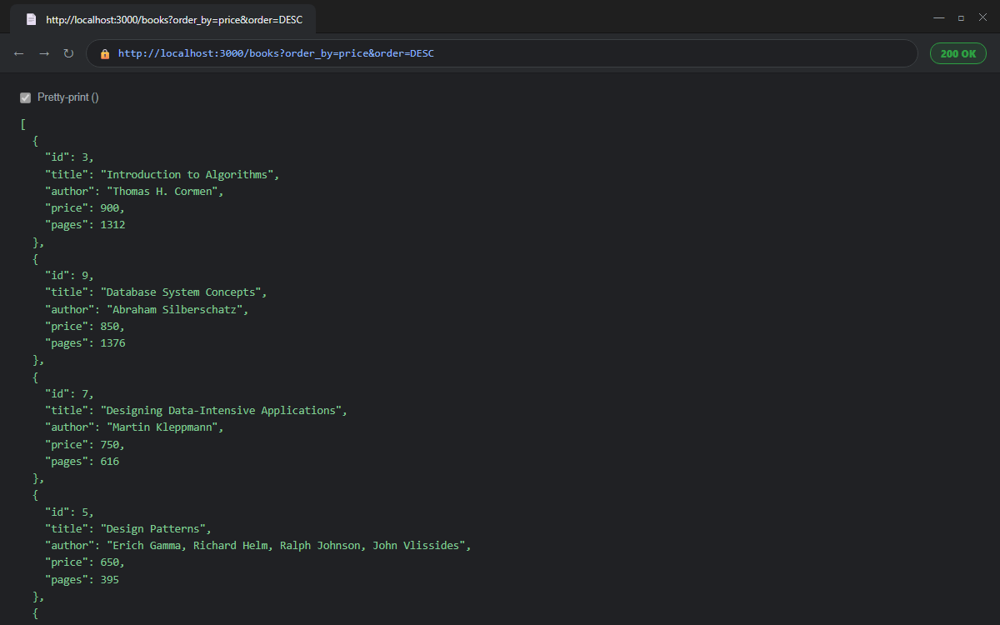
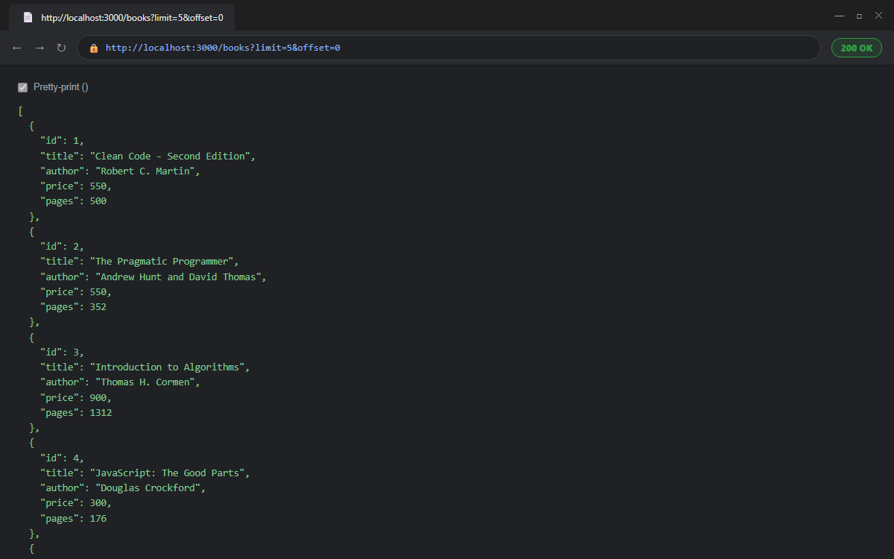
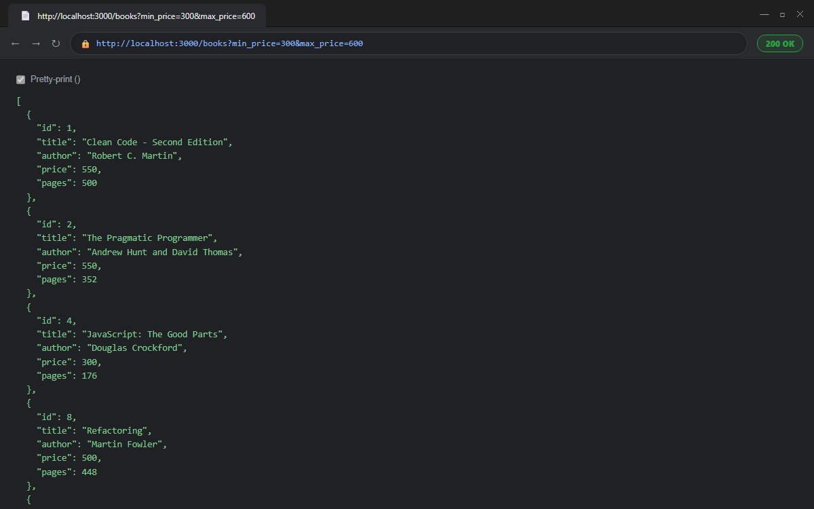
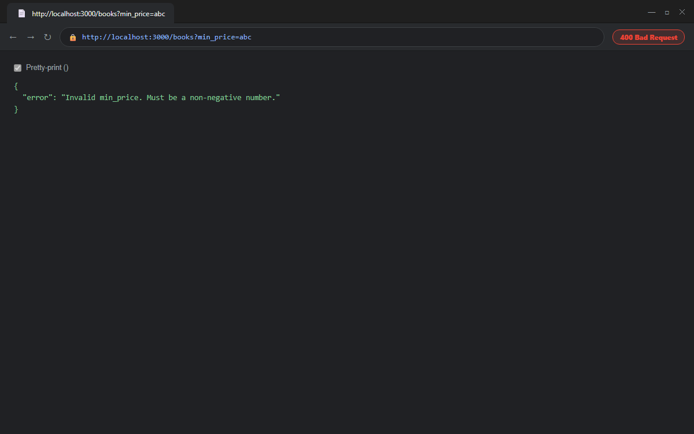
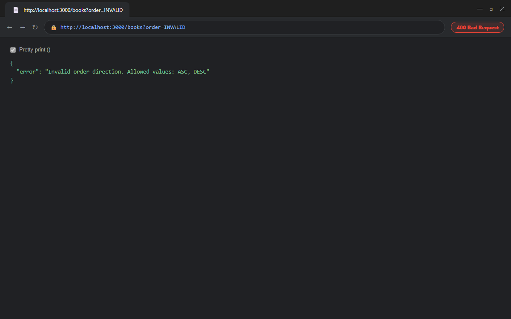

# Lab 03: REST API, Query Parameters, Validation and Debugging

**Student Name:** Rajamoni Naveen  
**Registration Number:** 252U1R1210  
**Section:** CSE-2D  
**Course:** Backend Development Fundamentals (Year II Term II)

---

## Repository & Links

- **GitHub Repository:** [https://github.com/naveenrajamoni89-lab/backend-lab-3](https://github.com/naveenrajamoni89-lab/backend-lab-3)

---

## Project Overview

This project is an advanced iteration of the Books REST API built with **Node.js**, **Express.js**, and **SQLite**. It extends the foundational CRUD capabilities from Lab 02 by introducing:
- **RESTful Noun-Based Routing** adhering to standard conventions (`/books`).
- **Query Parameter Handling** for partial search (`search_q`), multi-column sorting (`order_by`, `order`), pagination (`limit`, `offset`), and price range filtering (`min_price`, `max_price`).
- **Strict Input Validation** on request bodies (`POST` / `PUT`) and query parameters (`GET`).
- **Standardized HTTP Status Codes** (`200 OK`, `201 Created`, `400 Bad Request`, `404 Not Found`, `500 Internal Server Error`).
- **Comprehensive Debugging Guidelines** resolving real-world backend pitfalls (`EADDRINUSE`, path resolutions, table name mismatches, and async synchronization).

---

## Technologies Used

- **Node.js** (v20+ LTS recommended) – Asynchronous runtime environment
- **Express.js** (v5.x) – Fast, unopinionated web framework
- **SQLite3 & SQLite** – Relational database engine and promise-based abstraction layer
- **Nodemon** – Development hot-reloading tool

---

## Database Schema

The application persists data in a local SQLite database (`books.db`) using the singular table `book`:

```sql
CREATE TABLE IF NOT EXISTS book (
    id INTEGER PRIMARY KEY,
    title TEXT,
    author TEXT,
    price INTEGER,
    pages INTEGER
);
```

### Pre-seeded Records
The database contains 10 baseline books spanning IDs 1 through 10 (*Clean Code*, *The Pragmatic Programmer*, *Introduction to Algorithms*, *JavaScript: The Good Parts*, *Design Patterns*, etc.).

---

## RESTful API Endpoints

| Method | Endpoint | Description | Status Codes |
|---|---|---|---|
| **GET** | `/` | Welcome page with student information and links | `200 OK` |
| **GET** | `/books` | Retrieve books with filtering, search, sorting & pagination | `200 OK`, `400 Bad Request`, `500 Server Error` |
| **GET** | `/books/:bookId` | Retrieve a single book by ID | `200 OK`, `400 Bad Request`, `404 Not Found`, `500 Server Error` |
| **POST** | `/books` | Create a new book with validation | `201 Created`, `400 Bad Request`, `500 Server Error` |
| **PUT** | `/books/:bookId` | Update an existing book by ID | `200 OK`, `400 Bad Request`, `404 Not Found`, `500 Server Error` |
| **DELETE** | `/books/:bookId` | Delete a book by ID | `200 OK`, `400 Bad Request`, `404 Not Found`, `500 Server Error` |
| **ALL** | `*` | Catch-all handler for undefined routes | `404 Not Found` |

*Note: All endpoints seamlessly accept both standard noun paths (e.g., `/books`) and trailing slashes (e.g., `/books/`).*

---

## Query Parameters on `GET /books`

The `GET /books` endpoint supports dynamic, composable query parameters:

| Parameter | Type | Default | Description & Validation | Example |
|---|---|---|---|---|
| `search_q` | String | *None* | Performs partial title matching via SQL `LIKE ?` (`%search_q%`). | `/books?search_q=Code` |
| `min_price` | Number | *None* | Minimum price filter (`price >= min_price`). Must be $\ge 0$. | `/books?min_price=400` |
| `max_price` | Number | *None* | Maximum price filter (`price <= max_price`). Must be $\ge 0$ and $\ge min\_price$. | `/books?max_price=700` |
| `order_by` | String | `id` | Sort column. Allowed: `id`, `title`, `author`, `price`, `pages`. | `/books?order_by=price` |
| `order` | String | `ASC` | Sort order. Allowed: `ASC`, `DESC` (case-insensitive). | `/books?order=DESC` |
| `limit` | Integer | `10` | Maximum number of books to return. Must be an integer $\ge 0$. | `/books?limit=5` |
| `offset` | Integer | `0` | Number of records to skip. Must be an integer $\ge 0$. | `/books?offset=5` |

### Query Examples

1. **Search with Partial Match:**
   ```http
   GET /books?search_q=Design
   ```
2. **Price Range Filtering:**
   ```http
   GET /books?min_price=300&max_price=600
   ```
3. **Sorted Pagination (Highest price first, page 2 of size 3):**
   ```http
   GET /books?order_by=price&order=DESC&limit=3&offset=3
   ```
4. **Composed Query (Search, Filter, Sort, and Paginate):**
   ```http
   GET /books?search_q=Data&min_price=500&order_by=price&order=ASC&limit=5&offset=0
   ```

---

## Browser Verification Screenshots (GET /books Query Parameters)

The following tests were executed directly in the browser against the live Express server (`http://localhost:3000`).

### 1. Get All Books
- **URL:** `http://localhost:3000/books`
- **Response:** `200 OK` – Returns all 10 baseline books with default ordering by `id ASC`.


---

### 2. Search Books (Partial Title Matching)
- **URL:** `http://localhost:3000/books?search_q=Design`
- **Response:** `200 OK` – Matches *Design Patterns* and *Designing Data-Intensive Applications*.


---

### 3. Ascending Sort
- **URL:** `http://localhost:3000/books?order_by=price&order=ASC`
- **Response:** `200 OK` – Lowest price books first (e.g., 250, 300, 400, 500, ...).


---

### 4. Descending Sort
- **URL:** `http://localhost:3000/books?order_by=price&order=DESC`
- **Response:** `200 OK` – Highest price books first (e.g., 900, 850, 750, 650, ...).


---

### 5. Pagination
- **URL:** `http://localhost:3000/books?limit=5&offset=0`
- **Response:** `200 OK` – Paginated to a maximum of 5 records for the first page.


---

### 6. Price Range Filtering
- **URL:** `http://localhost:3000/books?min_price=300&max_price=600`
- **Response:** `200 OK` – Returns only books with prices between 300 and 600 inclusive.


---

### 7. Invalid Price Validation
- **URL:** `http://localhost:3000/books?min_price=abc`
- **Response:** `400 Bad Request` – Structured error response: `{"error": "Invalid min_price. Must be a non-negative number."}`.


---

### 8. Invalid Sorting Direction Validation
- **URL:** `http://localhost:3000/books?order=INVALID`
- **Response:** `400 Bad Request` – Whitelist validation rejection: `{"error": "Invalid order direction. Allowed values: ASC, DESC"}`.


---

## Validation and Error Responses

Consistent, structured JSON error objects are returned across all endpoints:

```json
{
  "error": "Error description message"
}
```

### 1. `GET /books` Validation
- Invalid `order_by` returns `400 Bad Request`:
  `{ "error": "Invalid order_by column. Allowed values: id, title, author, price, pages" }`
- Invalid `order` direction returns `400 Bad Request`:
  `{ "error": "Invalid order direction. Allowed values: ASC, DESC" }`
- Negative `limit` or `offset` returns `400 Bad Request`:
  `{ "error": "Invalid limit. Must be a non-negative integer." }`
- Non-numeric or inverted price range returns `400 Bad Request`:
  `{ "error": "min_price cannot be greater than max_price." }`

### 2. `POST /books` Validation
- Requires `title` (non-empty string), `author` (non-empty string), and numeric `price` (number $\ge 0$).
- Accepts optional `pages` (positive integer).
- On success: returns `201 Created` with:
  ```json
  {
    "message": "Book created successfully",
    "bookId": 11
  }
  ```

### 3. `PUT /books/:bookId` and `DELETE /books/:bookId`
- Invalid ID format (e.g. `/books/abc`) returns `400 Bad Request`.
- Non-existent ID returns `404 Not Found`:
  ```json
  {
    "error": "Book not found"
  }
  ```
- Successful update or deletion returns `200 OK`:
  ```json
  {
    "message": "Book updated successfully"
  }
  ```

---

## Debugging Common Backend Pitfalls

### 1. `EADDRINUSE` (Port Already in Use)
- **Problem:** Attempting to start the Express application when port `3000` is already bound by a previous background process or hung instance throws:
  ```
  Error: listen EADDRINUSE: address already in use :::3000
  ```
- **Solutions:**
  - **Dynamic Port Assignment:** Read the port from `process.env.PORT || 3000` so alternate ports can be supplied on demand (`PORT=3001 npm start`).
  - **Process Termination on Windows:**
    ```powershell
    # Find process ID listening on port 3000
    netstat -ano | findstr :3000
    # Terminate process by PID
    taskkill /PID <PID> /F
    ```
  - **Quick Utility:** Run `npx kill-port 3000`.

### 2. Incorrect Import Paths
- **Problem:** Using relative file strings like `'./books.db'` fails if Node is invoked from another working directory.
- **Solution:** Always compute absolute paths using Node's `path` module:
  ```javascript
  const path = require('path');
  const dbPath = path.join(__dirname, 'books.db');
  ```

### 3. SQLite Table-Name Errors
- **Problem:** While REST conventions use plural resource names (`/books`), the underlying database table is named `book` (singular). Querying `SELECT * FROM books;` produces:
  ```
  SqliteError: no such table: books
  ```
- **Solution:** Keep SQL queries strictly targeting the singular `book` table while mapping Express route handlers to the plural `/books`.

### 4. Missing `await` in Asynchronous Database Operations
- **Problem:** SQLite driver operations (`open()`, `db.all()`, `db.get()`, `db.run()`) return Promises. Omitting `await` causes Express to send empty responses or unhandled rejections:
  ```javascript
  // Bug: returns Promise { <pending> } rather than data
  const books = db.all(query);
  response.json(books);
  ```
- **Solution:** Mark route handlers as `async` and consistently `await` every database call inside structured `try...catch` blocks:
  ```javascript
  try {
    const books = await db.all(query, params);
    response.status(200).json(books);
  } catch (error) {
    response.status(500).json({ error: 'Internal Server Error' });
  }
  ```

---

## How to Run & Verify

1. **Install Dependencies:**
   ```bash
   npm install
   ```

2. **Run in Development Mode:**
   ```bash
   npm run dev
   ```

3. **Run in Production Mode:**
   ```bash
   npm start
   ```

4. **Verify Endpoints:**
   - Home: `http://localhost:3000/`
   - All Books: `http://localhost:3000/books`
   - Search: `http://localhost:3000/books?search_q=Algorithms`
   - Filtered: `http://localhost:3000/books?min_price=400&max_price=800`
   - Sorted: `http://localhost:3000/books?order_by=price&order=DESC`
